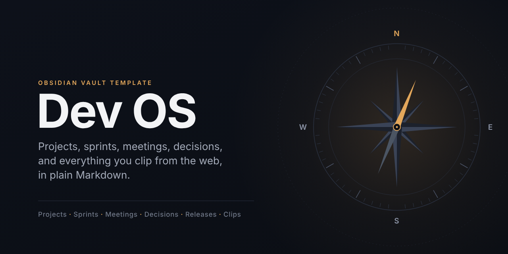
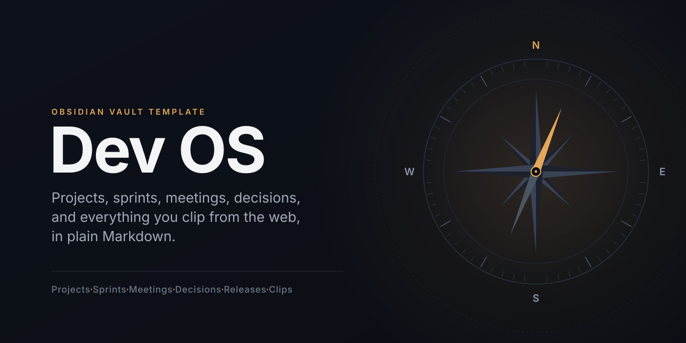

<p align="center"></p>
<!-- Fallback if the PNG is missing: <p align="center"></p> -->

# Dev OS

*An Obsidian workspace for developers and IT project managers: projects, sprints, meeting minutes, decisions, and everything you clip from the web, in plain Markdown.*

Dev OS is an Obsidian vault plus a first-party plugin that turns it into an interactive dashboard. You add tasks, move sprint cards, write meeting minutes, change project and decision status, and triage web clippings without leaving the Dev OS view. Every click writes ordinary Markdown and properties, so the notes stay readable, searchable, and usable by the Tasks, Dataview, and Kanban plugins and by any AI agent that follows `AGENTS.md`.

It grew out of Compass, a life-planning template. The personal layer (journal, daily questions, habits, quarterly retreats, reading plan) is still there, hidden by default; turn it on in **Settings, Dev OS, Show personal modules**.

**Status: development candidate.** Requires Obsidian 1.13.1 or newer. Core dashboard mobile compatibility needs native testing; Agent Client and the local API bridge are desktop-only.

## Quick start

1. Clone this repository or download the zip. The repository root is the vault.
2. Open the folder in Obsidian (Open folder as vault).
3. When Obsidian asks about Restricted mode, click **Turn off**, then run **Reload app without saving** so the community plugins and Dev OS load. Dev OS opens automatically (Ctrl/Cmd+Shift+L).
4. Open **View, Show sample data** in the Dev OS topbar to see the example project, sprint, meeting, ADR, and clipping. Hide them again once your own notes exist.
5. Create your first project (**Projects, New project**), open it, and add tasks and meeting minutes from the project page.
6. Install Obsidian Web Clipper in your browser and import the templates from `Meta/Web Clipper/` (`Guide/24 Web Clipper.md`).

Notes tagged `example` are seed data; the Setup checklist (`00 Dashboards/Setup.md`) reminds you to delete them.

## What the Dev OS view does

| Screen | What you do there | What it writes |
| --- | --- | --- |
| Home | See what needs attention, the active sprint, today's meetings, the clip inbox; quick-add a task | task lines |
| Today | Standup drafted from tasks (done since last working day, due or in progress, `#blocked`); copy it or write it to the daily note | `## Standup` in the daily note, task lines |
| Projects | Change status and priority on each card, see progress and overdue counts | project properties |
| Project page | Edit status, priority, target date, repo, stakeholders; tabs for Tasks (add with due, scheduled, sprint, owner, priority, blocked), Meetings (minutes composer and timeline), Docs, Clips | project properties, task lines under `## Tasks`, new meeting notes, `## Notes` in a meeting |
| Sprint | Board with To do, In progress, Done; start, finish, reopen; start or close the sprint | task status (`[ ]`, `[/]`, `[x]`), sprint status |
| Meetings | Minutes composer, upcoming and recent meetings, open action items | new meeting notes, task lines |
| Docs | ADRs, tech notes, postmortems with filters; status from a dropdown; auto-numbered new ADRs | doc properties, new notes |
| Inbox | Triage Web Clipper clips: assign a project, mark read, archive, keep as a tech note | clip properties, one file move |
| Tasks, People, Library, Brain, AI | Every open task, people with discussion items, books and clips, the link graph, AI readiness | task lines |

All writes go through one class in the plugin, happen only on an explicit click, never overwrite an existing note, and refuse to change a task line that changed since it was read. The plugin makes no network requests. Details: `Guide/21 Life OS Application.md`.

## What is inside

```
00 Dashboards/   Setup, Task, Projects, Sprint, Decisions, Boards, Assistant (+ personal: Compass, Habit Canvas, Daily Questions)
01 Journal/      Daily notes (Standup, Work log, Journal), Weekly, Quarterly
02 Retreats/     quarterly personal retreats (personal layer)
03 Planning/     Life Theme, Core Values, Ideal Week (personal layer)
04 Projects/     project notes (#project/<slug> tasks), Sprints/ (#sprint/<slug>), Projects Board
05 People/       teammates and stakeholders (#p/<slug> tasks, #discuss roll-ups)
06 Writing/      Decisions (ADRs), Tech Notes, Postmortems, Articles (with a Kanban board)
07 Library/      Clippings (Web Clipper inbox), Book Notes
08 Tasks/        Tasks.md, the master inbox
09 Reading/      reading plan module (personal layer, optional)
10 Meetings/     meeting minutes: agenda, notes, decisions, action items
Prompts/         18 prompts for your AI agent, one note per recurring job
Templates/       Templater templates for every note type
Meta/            Compass Config.md (folders, questions, habits), Web Clipper/ templates, views/*.js
Guide/           how the system works, one page per workflow
wiki/, inbox/    knowledge layer for the claude-obsidian plugin (optional)
scripts/         template build and verify, reading plan generator
  .github/         CI workflow (verify) and issue templates
CHANGELOG.md, CONTRIBUTING.md, SECURITY.md, CODE_OF_CONDUCT.md, CREDITS.md, LICENSE, LICENSE-GUIDE.md, THIRD_PARTY_NOTICES.md
.claude-obsidian.json  marker for the claude-obsidian knowledge layer
AGENTS.md        rules and folder map for any AI agent; CLAUDE.md and GEMINI.md point to it
.claude/         settings.json: read-only MCP tool allowlist for Claude Code (no secrets)
.mcp.example.json  how to point an agent at Obsidian's MCP server (Local REST API)
```

`Meta/Compass Config.md` is the single config: folders for projects, sprints, meetings, decisions, docs, and clippings, plus the personal layer's questions, habits, and wheel areas.

## Conventions

- Tasks use the Obsidian Tasks emoji format: `📅` due, `⏳` scheduled, `⏫` high, `➕` created, `✅` done. `- [/]` is in progress.
- Routing tags: `#project/<slug>` (project), `#sprint/<slug>` (sprint), `#p/<slug>` (owner or person), `#blocked`, `#discuss`. The slug is the note title lowercased, with non-alphanumerics replaced by `-`.
- Notes link to their project with a `project: "[[Project name]]"` property (sprints, meetings, ADRs, tech notes, postmortems, clippings).
- An accepted ADR is never rewritten. A new ADR supersedes it.

## Workflows

| Workflow | Where it lives | Guide |
| --- | --- | --- |
| Tasks, projects, and sprints | `08 Tasks`, `04 Projects`, `04 Projects/Sprints`, Task and Sprint dashboards | `Guide/08 Workflow - Task Management.md` |
| Meetings and standups | `10 Meetings`, the daily note's Standup section | `Guide/08 Workflow - Task Management.md` |
| Decisions and docs | `06 Writing/Decisions`, `Tech Notes`, `Postmortems`, `Articles` | `Guide/09 Workflow - Writing.md` |
| Web clipping and research | `07 Library/Clippings`, `wiki/` | `Guide/24 Web Clipper.md`, `Guide/15 claude-obsidian.md` |
| Personal layer (optional) | journal, daily questions, habits, retreats, reading | `Guide/03` to `Guide/07` |

Start with `Guide/00 Start Here.md`.

## Plugins included

All ten community plugins are bundled under `.obsidian/plugins/`, each with a recorded version and license, and are listed as enabled. Byte-for-byte upstream provenance is a separate release check. The first-party `life-os-app` plugin (Dev OS) is installed alongside them. Details and the first-open checklist are in `Guide/02 Plugins.md`.

| Plugin | Id | Version | License |
| --- | --- | --- | --- |
| Dataview | `dataview` | 0.5.68 | MIT |
| Templater | `templater-obsidian` | 2.25.0 | AGPL-3.0 |
| Periodic Notes | `periodic-notes` | 0.0.17 | MIT |
| QuickAdd | `quickadd` | 2.23.0 | MIT |
| Tasks | `obsidian-tasks-plugin` | 8.4.0 | MIT |
| Kanban | `obsidian-kanban` | 2.0.51 | GPL-3.0 |
| Omnisearch | `omnisearch` | 1.30.1 | GPL-3.0 |
| Local REST API | `obsidian-local-rest-api` | 5.1.0 | MIT |
| Agent Client | `agent-client` | 0.12.1 | Apache-2.0 |
| SEO | `seo` | 0.5.6 | MIT |

The first-party Dev OS application (`life-os-app`) is separately versioned and licensed under MIT. It is the interactive dashboard and the only first-party code that writes to notes. See `Guide/21 Life OS Application.md`.

Upstream repositories and release tags are in `THIRD_PARTY_NOTICES.md`. Obsidian itself is not included.

## AI agents in the vault

- `AGENTS.md` is the canonical instruction file for any agent: folder map, property conventions, safety rules (read before write, ask before edit, never rewrite journal or planning text). `CLAUDE.md` and `GEMINI.md` point to it.
- `Prompts/` holds 18 recurring jobs, one note per job (standup draft, sprint review, meeting prep, project kickoff, task triage, docs and ADR drafting, research capture, board grooming, what matters today, vault health check, onboarding, and the personal-layer reviews). Each note carries its own `risk` level and a button; see `Guide/20 Prompt Library.md`.
- Agent Client (`agent-client`) runs a local agent (Claude Code, Codex, Gemini CLI, and others) over the Agent Client Protocol and puts the chat in the sidebar or inside a note. Every edit is shown as a diff and needs approval; auto-allow ships off. See `Guide/14 Agent Client and Claude Code.md`.
- The Obsidian MCP bridge: Local REST API 5.x serves an MCP server at `http://127.0.0.1:27123/mcp` (16 tools: open notes, run commands, search, read, patch). `.mcp.example.json` shows the client config; `.claude/settings.json` pre-approves the read-only tools for Claude Code. See `Guide/19 Obsidian MCP Bridge.md`.
- No keys ship. Local REST API generates a per-install key on first load; each member registers the server in their own agent (for Claude Code, `claude mcp add --scope user ...`) with that key kept outside the vault. `.mcp.json`, agent sessions, and exported chats are excluded by `.gitignore` and by the build.

## Build and release


The template is built from the maintainer's live vault, never edited in the built copy:

```bash
python3 scripts/verify_release_safety.py
python3 scripts/build_template.py --out ../life-os-releases --name LifeOS-1.1.0-candidate --version 1.1.0 --zip
python3 scripts/verify_template.py ../life-os-releases/LifeOS-1.1.0-candidate
```

`build_template.py` copies with drop rules, keeps only `example`-tagged notes in user folders, resets defaults, strips machine state from plugin settings, adds the version and a one-page workspace, then verifies and zips. `verify_template.py` exits 1 on any failure: forbidden strings (names, paths, keys, certificates, em dashes), plugin settings (Local REST API exactly `{"enableInsecureServer": true}`, Agent Client with no sessions and auto-allow off, Omnisearch HTTP server off, QuickAdd online features off), plugin folders with LICENSE, notices matching manifests, referenced paths and wikilinks resolving, `Meta/views/*.js` syntax under Node, and total size under 20 MB. The `verify` workflow runs it on every push and pull request. Maintainer checklist: `scripts/RELEASE.md`. Changes: `CHANGELOG.md`.

There is no transactional in-place upgrader. Back up the complete vault, extract a new release beside it, and migrate personal content, custom configuration, and templates with conflict review. Do not replace the working `.obsidian` folder wholesale. A backup is not proven until a restore has been tested. See `scripts/RELEASE.md` and `Guide/23 Native Acceptance.md`.

## Credits and license

The original personal workflows follow Mike Schmitz's public talk "How I Run My Whole Life Out of Obsidian" (Practical PKM); Dev OS is an independent implementation and is not affiliated with Practical PKM. Daily questions: Marshall Goldsmith and Mark Reiter, *Triggers* (2015). Multi-scale planning: Cal Newport. Full credits in `CREDITS.md`.

Code, templates, dashboards, scripts, and configuration are MIT (`LICENSE`). The prose in `Guide/` is CC BY 4.0 (`LICENSE-GUIDE.md`). Third-party plugin binaries under `.obsidian/plugins/` keep their own licenses; see `THIRD_PARTY_NOTICES.md`. Community rules: `CODE_OF_CONDUCT.md`.

Contributing: `CONTRIBUTING.md`. Security: `SECURITY.md`.
